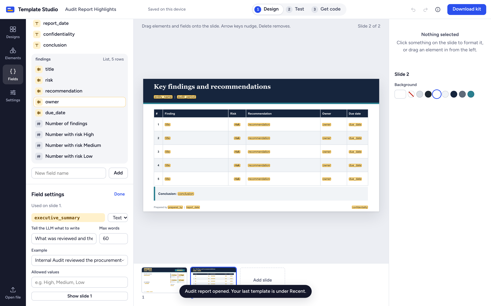
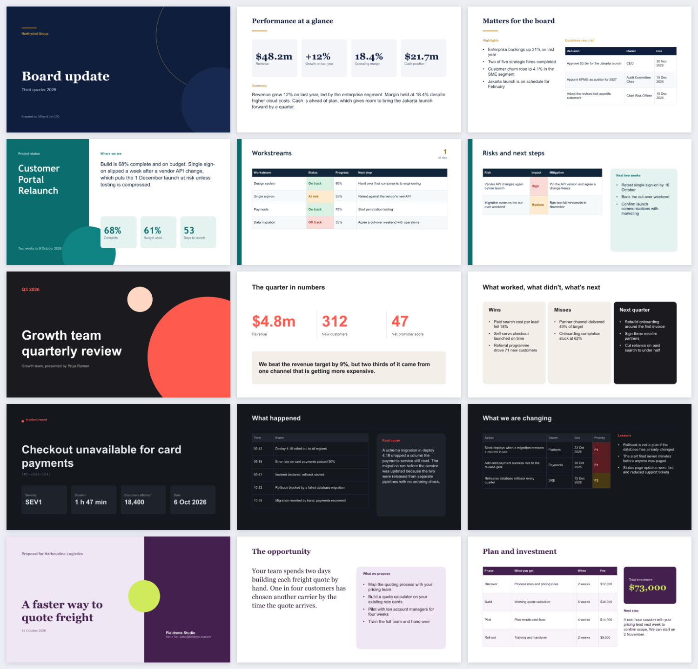
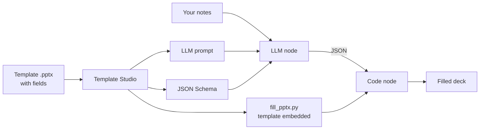

# Template Studio

**Live app: https://kabuto57.github.io/template-studio/**

Template Studio turns a PowerPoint template into everything an LLM needs to fill it in. You design the
slides (or open your own `.pptx`), mark the blanks as fields, and get three things to paste into a
[Dify](https://dify.ai) workflow: a system prompt, a JSON schema, and a Python script that pours the LLM's
answer into your slides. It is free, it runs entirely in your browser, and your files never leave your
computer.


## What you can do

| | |
|---|---|
| **Design** | Start from six finished decks or a blank slide, or open your own PowerPoint. Drag in titles, text, bullet lists, number tiles and tables. Move, resize, restyle and reorder anything, including shapes from your own file. |
| **Mark the fields** | Drag fields such as `{{report_title}}` or `{{findings.1.risk}}` onto text boxes and table cells. Tell the LLM what each one is for: a description, a word limit, examples, allowed values. |
| **Test** | Paste the JSON an LLM returned and watch the slides fill. See what was left blank. Download the finished deck. |
| **Get code** | Copy the prompt, the example JSON or JSON Schema, and the Python. Or download the whole kit as a zip. |




The built-in designs, each filled with its sample data:



## How it works



The template is the single source of truth. Template Studio reads the `{{fields}}` out of it and derives
the prompt, the schema and the code, so the three always agree with the slides.

### Placeholder rules

| In the template | Meaning |
|---|---|
| `{{report_title}}` | Text. Replaced in place, keeping the font, size and colour. |
| `{{key_highlights}}` alone in a paragraph, with a JSON list | One paragraph (bullet) per item. |
| `{{client.name}}` | A group: `{"client": {"name": "..."}}` |
| `{{findings.2.title}}` | Item 2 of a list. Put `.1.`, `.2.`, `.3.` in table rows. |
| `{{count:findings}}`, `{{count:findings.risk=High}}` | Calculated counts. Never part of the LLM's JSON. |
| A table row whose fields all come out empty | The row is removed, so 3 findings in a 5-row table leave no gaps. |
| Colour rules | A table cell whose whole text matches a rule (for example High, Medium, Low) gets that fill and text colour. |

Fields the JSON leaves out become blank and are reported in the script's `message`.

## Privacy

Everything happens in your browser. Templates, field settings and test data are read from your disk,
processed in memory and saved to your browser's own storage (IndexedDB). There is no server, no account,
no analytics and no third-party request: every dependency, font included, is bundled. After the first
visit the app works offline, and a test in CI fails the build if the page makes a network request after
loading.

## Use it with Dify

1. In Template Studio, open **Get code**.
2. **LLM node**: paste the prompt as the system prompt. If your model supports structured output, paste
   the JSON Schema there too. In a Workflow, replace `{{#sys.query#}}` with your own input variable.
3. **Code node** (Python 3): paste `fill_pptx.py`.
   - Input variable `content_json` (String): the LLM node's text output.
   - Output variables `pptx_base64`, `file_name`, `status`, `message` (all String).
4. A Code node returns text, not files. `pptx_base64` is the finished deck as base64. To get the file,
   decode it in whatever receives your workflow's result, or paste it into **Test → Turn Dify's output
   into a file**.

The script uses only the Python standard library (3.8 or newer), reads no files and makes no network
calls, so it runs inside Dify's sandbox as it is. Dify limits the length of a Code node's string output
(`CODE_MAX_STRING_LENGTH`: 400,000 characters by default today, 80,000 in older self-hosted versions).
The Get code page shows how large your template's output is against that limit.

The same file runs on a laptop:

```bash
python fill_pptx.py content.json report.pptx
```

## On a computer where you cannot install anything

`pptx_kit.py` builds the same kit from a `.pptx` with plain Python: no installs, no internet, no
browser. Download it from the Get code page or from the
[latest release](https://github.com/Kabuto57/template-studio/releases/latest).

```bash
python pptx_kit.py                       # asks for your template, then rebuilds on every save
python pptx_kit.py build  template.pptx  # build the kit once
python pptx_kit.py fields template.pptx  # list the fields
python pptx_kit.py fill   template.pptx data.json out.pptx
```

Type `{{field_name}}` into the template in PowerPoint, save, and the kit folder next to it is rebuilt.
Edit `fields.json` in that folder to describe each field. A kit downloaded from the web app contains a
`fields.json` that `pptx_kit.py` reads, so you can move between the two.

## Develop

Requires Node 20+ and Python 3.8+ (Python is only used by the tests).

```bash
npm install
npm run dev          # http://localhost:5173
npm run build        # type-check, then build to dist/
npm test             # unit, engine parity, golden-file and Python tests
npm run test:e2e     # browser tests against the production build (first run: npx playwright install chromium)
npm run test:py      # structural check of every .pptx the tests wrote
```

A full walkthrough of the code is in [docs/Template-Studio-Guide.pdf](docs/Template-Studio-Guide.pdf)
(source: [docs/GUIDE.md](docs/GUIDE.md), rebuilt with `node scripts/guide-pdf.mjs`).
What the tests cover is described in [docs/ARCHITECTURE.md](docs/ARCHITECTURE.md#tests). A three-minute
demo script is in [docs/DEMO.md](docs/DEMO.md).

## Deploy your own copy (free)

The app is a static site: `npm run build` produces `dist/`, and its paths are relative, so the same
build works under any URL.

- **GitHub Pages**: fork the repo, then Settings → Pages → Source: *GitHub Actions*. Every push to `main`
  runs the tests and deploys.
- **Cloudflare Pages** or **Netlify**: connect the repo, build command `npm run build`, output directory
  `dist`.
- **Custom domain** (optional): add it under Settings → Pages → Custom domain and create the DNS record
  GitHub shows you. Nothing in the app needs to change.

## Limits worth knowing

- The slide preview draws the common cases (text, shapes, tables, pictures, groups, theme colours,
  layouts). Charts, SmartArt and effects are not drawn, but they are kept untouched in the file.
- Text does not shrink to fit. Use the word limits so the LLM writes to the space available.
- Very large whole numbers lose precision in the browser preview before Python would (a JavaScript
  limit); ordinary figures are identical in both.

## Licence

[MIT](LICENSE). The generated `fill_pptx.py` files are yours to use however you like.
