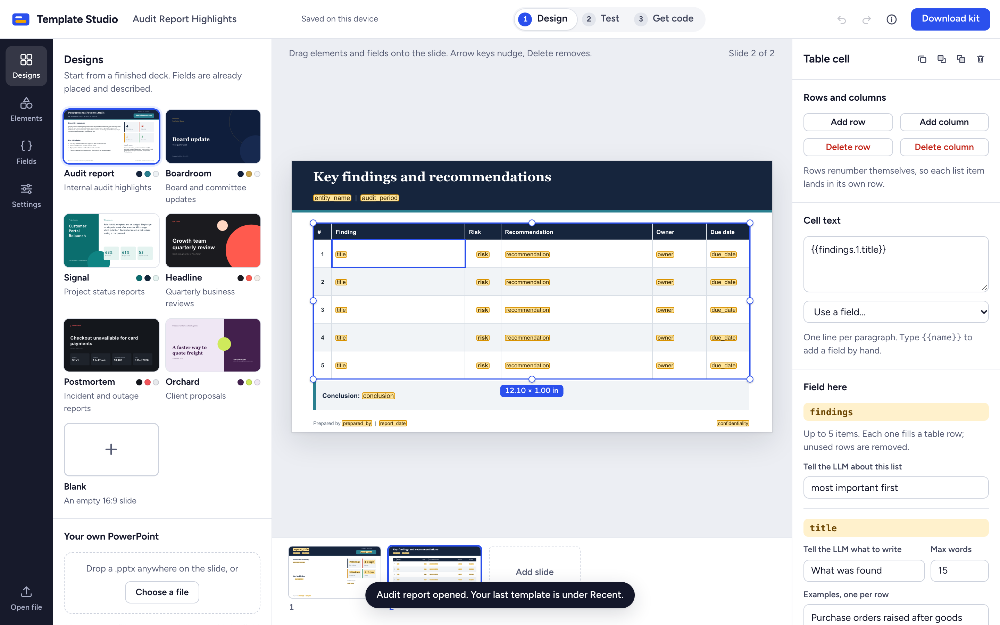
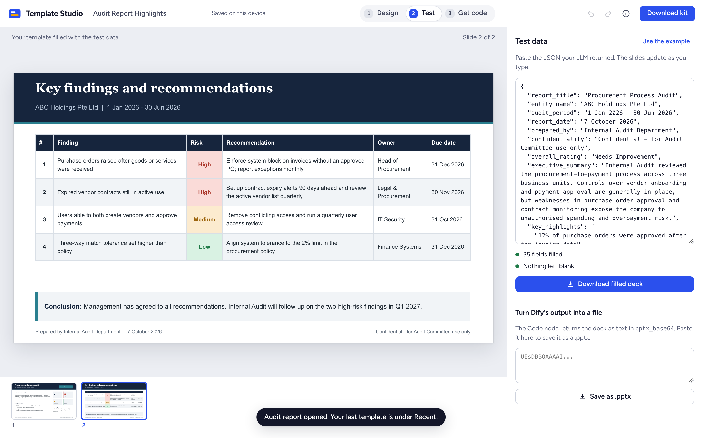
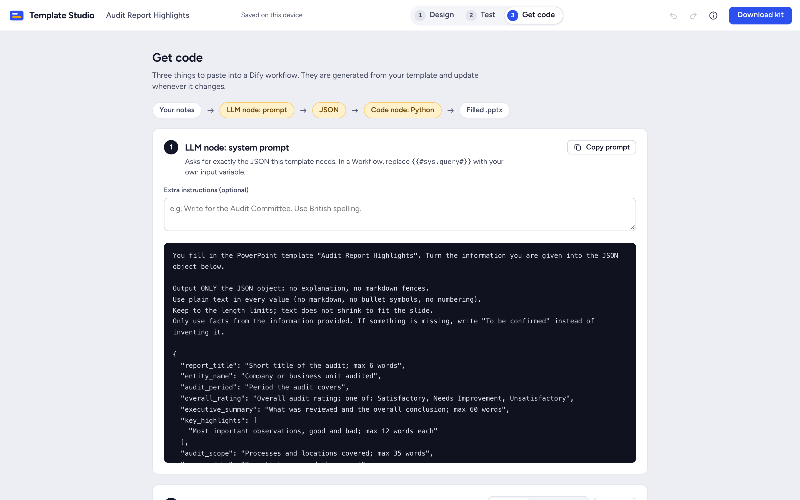

Live app: <https://kabuto57.github.io/template-studio/>
Source: <https://github.com/Kabuto57/template-studio>

# 1. What it is

Template Studio turns a PowerPoint template into everything an LLM needs to fill it in.

You design slides in the browser (or open your own `.pptx`) and mark the blanks as fields such as
`{{report_title}}`. The app then produces three things to paste into a [Dify](https://dify.ai) workflow:

1. **A system prompt** that tells the LLM exactly which JSON to write.
2. **A JSON Schema** for models that support structured output.
3. **A Python script** (`fill_pptx.py`) that pours the LLM's JSON into the slides and returns the
   finished deck.

It is a static website. There is no server, no account and no paid service. Templates never leave the
browser.



# 2. The idea in one picture

```
                      ┌──────────────────────┐
  template.pptx  ───▶ │   Template Studio    │
  with {{fields}}     │   (in the browser)   │
                      └──────────┬───────────┘
                                 │ derives
              ┌──────────────────┼──────────────────┐
              ▼                  ▼                  ▼
         LLM prompt         JSON Schema        fill_pptx.py
              │                  │           (template embedded)
              └────────┬─────────┘                  │
                       ▼                            │
  your notes ──▶  Dify LLM node  ── JSON ──▶  Dify Code node  ──▶  filled .pptx
```

The template is the single source of truth. The app reads the `{{fields}}` out of the slides and
derives the prompt, the schema and the code from them, so the three can never disagree with the slides.

# 3. How a person uses it

| Step | Screen | What happens |
|---|---|---|
| 1 | **Design** | Pick one of six designs, start blank, or open a `.pptx`. Drag elements and fields onto the slide. Describe each field for the LLM (what to write, word limit, example, allowed values). |
| 2 | **Test** | Paste JSON an LLM returned. The slides fill live and the panel lists anything left blank. Download the filled deck. |
| 3 | **Get code** | Copy the prompt, the example JSON or JSON Schema, and the Python. Or download everything as a zip. |





# 4. Technology

| Choice | Why |
|---|---|
| Vite + strict TypeScript | Fast build, type safety, one small static bundle. |
| Plain DOM, no framework | The slide canvas is drawn from PowerPoint XML and moved directly during a drag. A virtual DOM would not own it. The rest is a few panels that redraw from state. |
| Zero runtime dependencies | About 55 kB gzipped. Nothing to license, nothing that phones home. The only bundled third-party asset is the Figtree font. |
| Hand-written zip reader/writer | A `.pptx` is a zip. The browser's built-in `CompressionStream` does the compression, so no library is needed. |
| IndexedDB | Autosave and "Recent" list, stored in the browser only. |
| Service worker | After the first visit the app works with no connection. |
| GitHub Pages + GitHub Actions | Free hosting, tests and deploy on every push. |

# 5. Folder map

```
template-studio/
  index.html              The page shell: top bar, tool rail, panels, slide stage.
  src/
    main.ts               Entry point. Starts the app.
    styles.css            All styling and design tokens.
    sw.js                 Service worker (offline cache).
    zip/minizip.ts        Zip reader and writer.
    engine/engine.ts      The fill engine (browser copy).
    ooxml/
      xml.ts              XML namespaces and small DOM helpers.
      deck.ts             Deck: an open .pptx, plus undo and redo.
      render.ts           Draws a slide as HTML.
      edit.ts             Every change to a slide.
    model/
      fields.ts           Field model, example JSON, JSON Schema, prompt.
      python.ts           Assembles fill_pptx.py.
    templates/
      builder.ts          Builds a .pptx for a gallery design.
      designs.ts          The five gallery designs.
    persist/db.ts         Autosave in IndexedDB.
    ui/                   The interface (see section 9).
    assets/               Sample template, blank deck, sample data.
  python/
    engine.py             The fill engine (Python copy).
    kit_src.py            pptx_kit.py without the engine.
  scripts/                Build helper, screenshots, smoke test, this PDF.
  tests/                  Unit, parity, Python and browser tests.
  reference/              The original prototype, kept as the golden reference.
  docs/                   Architecture notes, demo script, this guide.
  .github/workflows/      ci.yml: test, deploy, release.
```

Everything outside `src/ui/` holds no app state. Those functions take a `Deck` and a `Project` and
return a result, which is why they can be tested without a browser.

# 6. The data model

Two objects describe an open template.

**Deck** (`src/ooxml/deck.ts`) is the `.pptx` itself: every part of the zip, the slide order, the slide
size, the theme, and the undo history.

**Project** (`src/model/fields.ts`) is what the user said about the fields:

```ts
interface Project {
  name: string;                         // template name, shown in the top bar
  settings: {
    file_name_field: string;            // which field names the output file
    colour_rules: ColourRule[];         // e.g. "High" -> red text on pink fill
  };
  fields: Record<string, FieldConfig>;  // per field: type, desc, max, example, allowed
  prompt_extra: string;                 // extra instructions for the LLM
}
```

A third object, the **Model**, is never stored. It is rebuilt from the slides every time something
changes, by scanning for `{{...}}`:

| Placeholder on a slide | Model entry | JSON the LLM writes |
|---|---|---|
| `{{report_title}}` | field | `"report_title": "..."` |
| `{{client.name}}` | object with children | `"client": {"name": "..."}` |
| `{{findings.1.title}}`, `{{findings.2.title}}` | array, max = highest index | `"findings": [{"title": "..."}]` |
| `{{count:findings}}` | calculated | nothing: the script computes it |

Because the Model comes from the slides, deleting a text box removes its field from the prompt, the
schema and the code in the same instant.

# 7. Placeholder rules

| In the template | Meaning |
|---|---|
| `{{report_title}}` | Text. Replaced in place, keeping font, size and colour. |
| `{{key_highlights}}` alone in a paragraph, given a JSON list | One paragraph (bullet) per item. |
| `{{client.name}}` | A group. |
| `{{findings.2.title}}` | Item 2 of a list. Put `.1.`, `.2.`, `.3.` in table rows. |
| `{{count:findings}}` | How many items the list has. |
| `{{count:findings.risk=High}}` | How many items have `risk` equal to `High`. |
| A table row whose fields all come out empty | The row is removed, so 3 findings in a 5-row table leave no gap. |
| Colour rule | A table cell whose whole text matches (for example High) gets that fill and text colour. |

Fields the JSON leaves out become blank and are listed in the script's `message`.

# 8. The core modules

## 8.1 Zip: `src/zip/minizip.ts`

A `.pptx` is a zip of XML files. `Zip.load(bytes)` reads the central directory and inflates entries on
demand. `zip.generate()` writes a new archive with a fixed timestamp, so the same input always gives the
same bytes. Compression uses the browser's `CompressionStream("deflate-raw")`. CRC-32 is computed with a
lookup table.

## 8.2 Deck: `src/ooxml/deck.ts`

`Deck.load(bytes)` opens the zip and indexes it:

- reads `ppt/presentation.xml` for the slide order and slide size,
- follows each slide's relationships to find its layout and master,
- keeps every XML part as text in `deck.texts`.

All edits go through two methods:

- `deck.mutate(part, fn, mergeKey?)` changes one part,
- `deck.transaction(put)` changes several parts at once (adding a slide touches five).

Both record the previous XML of each part they touch. **Undo** restores those and records the inverse
for **redo**. Typing and arrow-key nudging pass a merge key, so a burst of edits is one undo step.

## 8.3 Drawing a slide: `src/ooxml/render.ts`

`renderSlide(deck, index, options)` turns a slide's XML into HTML. It paints the master, then the
layout, then the slide, resolving theme colours, fonts, inherited placeholder positions, groups, tables
and pictures. Every size is written in container-relative units, so the same markup serves the large
editor slide, the filmstrip and the gallery covers.

With `highlight: true`, each `{{field}}` is wrapped in a yellow chip. With `editable: true`, shapes get
`data-obj` and text gets `data-edit` so the editor knows what was clicked.

Miniatures (filmstrip and gallery) are drawn at 1280 px wide and scaled down with a CSS transform.
Otherwise a browser's minimum font size would enlarge their tiny text and break the layout.

Charts, SmartArt and effects are not drawn. They are left untouched in the file.

## 8.4 Editing: `src/ooxml/edit.ts`

One function per user action: `insertBlock`, `setBox`, `resizeBox`, `alignObj`, `deleteObj`,
`duplicateObj`, `zOrder`, `setText`, `setStyle`, `tableOp`, `placeField`, `renameField`,
`addBlankSlide`, `duplicateSlide`, `moveSlide`, `deleteSlide`, `setSlideBackground`.

PowerPoint is strict about its file format and shows a "repair" prompt if a rule is broken. This module
encodes the rules:

- Edit the existing XML with the DOM and keep its namespace prefixes. Never rebuild a part from scratch.
- Child elements must be in schema order (for example `a:pPr` first in a paragraph; in `p:spPr`:
  position, geometry, fill, line).
- A new slide needs five things: the slide part, its relationships file, a content-type entry, a
  relationship from the presentation, and an id of 256 or more in the slide list. Deleting removes all
  five and any notes page.

## 8.5 The fill engine: `src/engine/engine.ts` and `python/engine.py`

This is the heart of the product. `fillXml(xml, data, report, colourRules)` takes one slide's XML and
the LLM's JSON and returns the filled XML.

How it works, per paragraph:

1. **Join the runs.** PowerPoint splits text into runs wherever it likes, so `{{report_title}}` may be
   stored as `{{rep` + `ort_title}}`. The engine joins the text of all runs in the paragraph.
2. **Find placeholders** in the joined text.
3. **Look up each value** in the JSON (`lookup` handles `a.b`, `list.N.sub` and `count:`).
4. **Write the value back** into the first run the placeholder touched and blank out the rest. The
   run's formatting is never rebuilt, so font, size and colour survive.
5. **Lists:** a paragraph that is exactly one placeholder with a list value is cloned once per item.

Then, per table: rows whose placeholders all came out empty are removed, and colour rules are applied
to cells whose whole text matches.

The report records what was replaced and what was missing.

### Why the engine exists twice

The browser preview (Test view) and the generated Python must give the same result, or the preview
lies. So the engine is written twice, line for line, with the same regular expressions in the same
order. A parity test runs both on about sixty fixtures and compares the output **byte for byte**. Any
change to one engine must be made in the other.

## 8.6 Prompt and schema: `src/model/fields.ts`

- `buildModel(scanned)` builds the Model from the scanned placeholders.
- `buildExample(project, model)` builds an example JSON object, using each field's example value.
- `buildSchema(project, model)` builds a JSON Schema (draft 2020-12): strings, arrays with `maxItems`,
  nested objects, `enum` for allowed values, everything required, no extra properties.
- `buildPrompt(project, model)` writes the system prompt: the rules, then the JSON shape with each
  field's description and word limit as its value.

## 8.7 The Python file: `src/model/python.ts`

`buildPython` assembles `fill_pptx.py` from four pieces:

```
"""docstring header: how to use it, table of fields"""
<python/engine.py, first half>          the fill engine
PROJECT = json.loads("...")             field settings
TEMPLATE_B64 = ( "UEsDB..." ... )       the whole .pptx, base64
<python/engine.py, second half>         main() and the command line
```

The app imports the real `python/engine.py` as text at build time, so there is no second copy that
could drift. The template is embedded in the script because a Dify Code node cannot read files.

The same file can be opened again in Template Studio: `parsePythonFile` extracts the template and the
field settings from it.

# 9. The interface: `src/ui/`

| File | Job |
|---|---|
| `state.ts` | The single state object `S` (deck, project, model, current slide, selection, view). |
| `app.ts` | Start-up, switching views, keyboard shortcuts, the About dialog. |
| `stage.ts` | The slide canvas: selection outline, drag to move, handles to resize, drag-and-drop targets, the filmstrip. |
| `side.ts` | Left panel: Designs gallery, Elements, Settings. |
| `fields.ts` | Left panel: the field list and each field's settings. |
| `inspector.ts` | Right panel: text, font, colours, alignment, arrange, slide background. |
| `outputs.ts` | Test panel and the Get code page. |
| `project.ts` | Opening, saving, the kit zip. |
| `dom.ts` | Small helpers: `el()`, icons, toast. |

The flow after any change is always the same:

```
user action ─▶ edit.ts changes deck XML ─▶ refresh()
                                             ├─ rescan placeholders ─▶ new Model
                                             ├─ redraw slide, filmstrip, panels
                                             └─ autosave (debounced) to IndexedDB
```

There is no partial update logic to get wrong: panels are redrawn from state.

# 10. What runs in Dify

**LLM node.** Paste the prompt as the system prompt. If the model supports structured output, paste the
JSON Schema too.

**Code node (Python 3).** Paste `fill_pptx.py`.

| | Name | Type |
|---|---|---|
| Input | `content_json` | String: the LLM node's text output |
| Output | `pptx_base64` | String: the finished deck |
| Output | `file_name` | String |
| Output | `status` | String: `success` or `error` |
| Output | `message` | String: what was filled, what was left blank |

Inside the Code node, `main(content_json)`:

1. parses the JSON (tolerating code fences and stray text around it),
2. decodes the embedded template,
3. runs `fill_xml` on every slide and notes page,
4. zips the result and returns it as base64.

The script uses only the Python standard library (3.8 or newer), reads no files and makes no network
calls, so it runs in Dify's sandbox unchanged.

A Code node returns text, not files. To get the file, decode `pptx_base64` wherever the workflow's
result is received, or paste it into **Test → Turn Dify's output into a file**.

Dify limits the length of a Code node's string output (`CODE_MAX_STRING_LENGTH`: 400,000 characters by
default, 80,000 in older self-hosted versions). The Get code page shows the template's size against
that limit.

The same file runs on a laptop:

```
python fill_pptx.py content.json report.pptx
```

# 11. `pptx_kit.py`: the no-install path

For a computer where nothing can be installed, `pptx_kit.py` builds the same kit from a `.pptx` using
plain Python: no browser, no internet.

```
python pptx_kit.py                       asks for a template, rebuilds on every save
python pptx_kit.py build  template.pptx  build the kit once
python pptx_kit.py fields template.pptx  list the fields
python pptx_kit.py fill   template.pptx data.json out.pptx
```

It is built from `python/kit_src.py` with `python/engine.py` spliced in (`scripts/build-kit.ts`). A test
checks that its output equals the web app's output exactly.

# 12. Privacy and offline

- Files are read with the browser's File API and processed in memory.
- Autosave goes to IndexedDB in the same browser. Nothing is uploaded.
- No analytics, no third-party requests. Fonts are bundled.
- `src/sw.js` caches the app's files on first visit. The list of files is generated at build time.
- A browser test fails the build if the page makes any network request after loading.

# 13. Tests

| Layer | File | What it proves |
|---|---|---|
| Unit | `tests/unit/zip.test.ts`, `engine.test.ts` | Zip round trips, CRC, every placeholder rule. |
| Parity | `tests/unit/parity.test.ts` | TypeScript and Python engines give identical XML. |
| Golden | `tests/unit/kit.test.ts` | Example, schema, prompt and header equal the prototype's. The Python file equals `pptx_kit.py`'s output. |
| Python | `tests/py/dify_run.py` | The generated file runs like a Dify Code node, with no site-packages, on Python 3.8 and 3.12. |
| Validity | `tests/py/check_pptx.py` | Every `.pptx` any test wrote: zip integrity, well-formed XML, consistent relationships. In CI also python-pptx and a LibreOffice PDF conversion. |
| Browser | `tests/e2e/app.spec.ts` | The whole flow in Chromium against the production build: build a template, test it, download the kit, reload, go offline, keyboard, phone width. |

131 tests in total (117 unit and 14 browser). python-pptx and LibreOffice are used in CI only, to check
the output. The product never depends on them.

```
npm install
npm run dev          http://localhost:5173
npm run build        type-check, then build to dist/
npm test             unit, parity, golden and Python tests
npm run test:e2e     browser tests
```

# 14. Build and deploy

`npm run build` type-checks and writes `dist/`. Two small Vite plugins run during the build:

- **kit plugin**: writes `pptx_kit.py` into the site so it can be downloaded,
- **offline plugin**: writes `sw.js` with the version and the list of built files.

Paths are relative, so the same build works under any URL.

`.github/workflows/ci.yml` runs on every push:

1. **test**: unit, parity, Python (3.8 and 3.12) and browser tests,
2. **deploy**: publishes `dist/` to GitHub Pages (main branch only),
3. **release**: on a `v*` tag, attaches `pptx_kit.py` to a GitHub release.

Everything used is free: GitHub Pages, GitHub Actions for public repositories, open-source tools.

# 15. How to extend it

**Add an element type.** Add an entry to `BLOCKS` in `src/ooxml/edit.ts`, return its XML from
`blockXml`, and add a small picture to `BLOCK_ART` in `src/ui/side.ts`. A test inserts every block type
and checks the resulting deck.

**Add a gallery design.** Add a `Design` to `src/templates/designs.ts`: slides built with `shape`,
`text` and `table` (positions in inches), field settings, and realistic test data. Tests fail if a field
has no settings, if the test data leaves anything blank, or if the deck is too large for Dify.

**Change the fill rules.** Change `src/engine/engine.ts` and `python/engine.py` together and add a
fixture to the parity test.

# 16. Known limits

- The preview does not draw charts, SmartArt or effects. They are kept in the file.
- Text does not shrink to fit. Use word limits so the LLM writes to the space available.
- If the browser enforces a minimum font size, very small text on the main editing slide appears
  slightly larger than in PowerPoint. The output file is not affected.
- Generated decks are checked with python-pptx, LibreOffice and macOS Quick Look. They have not been
  opened in the PowerPoint application as part of automated testing.
- There is no Word (`.docx`) output and no importable Dify workflow file.
